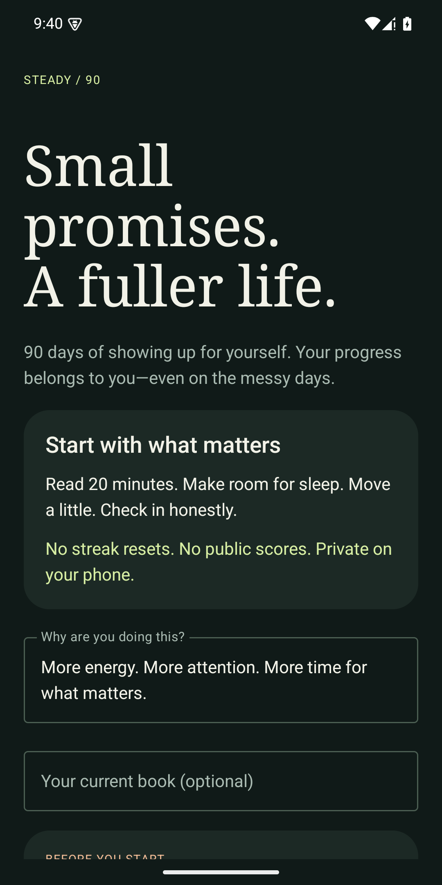
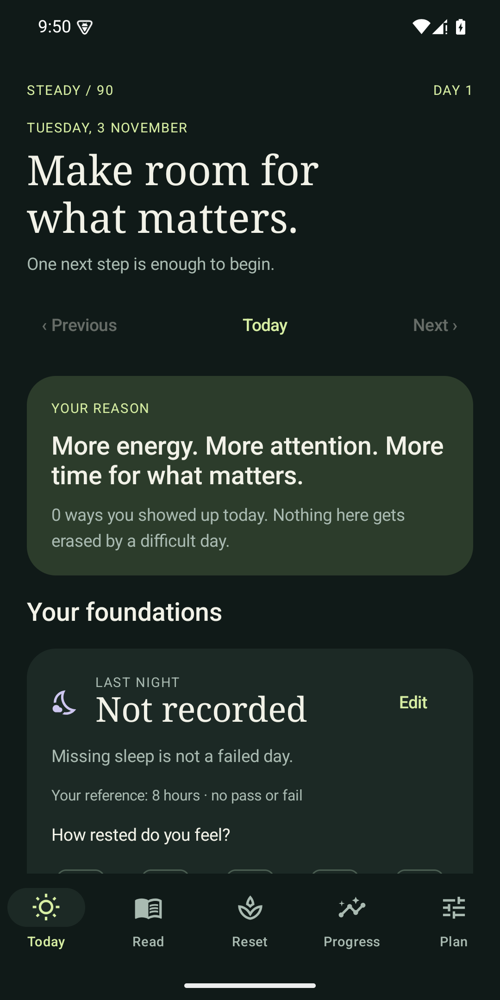
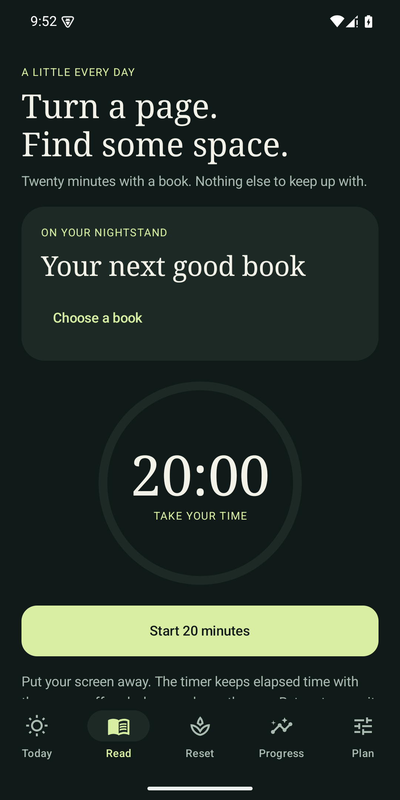

# Steady 90

A native Android habit companion built with Kotlin and Jetpack Compose (v0.2.0). Local, encrypted records; no account, analytics, advertising or Internet permission.

## Previews

| Welcome | Today | Reading |
| --- | --- | --- |
|  |  |  |

## Install the personal preview

Download `steady90-preview.apk` from [GitHub Releases](../../releases) (or build it locally with `./gradlew assembleRelease`) for an Android 9 or newer phone. Transfer the file to your phone, open it and allow installation from that file manager when Android asks. This is a debug-signed personal preview, not a Google Play release. Keep the installed app when updating with a newer APK signed by the same key; uninstalling deletes its private records.

1. Complete the short setup and choose your reason and book.
2. In Google Fit: **Profile → Settings → Health Connect → Sync Fit with Health Connect**. Allow sleep and steps to be shared.
3. In Steady 90: **Plan → Connect Health Connect**, then grant read access to sleep and steps.
4. Sync your wristband with its companion app, then reopen Steady 90 or tap **Sync now**.
5. If sleep is missing, check Health Connect itself for sleep records and the source app's write permission. Seeing sleep in Google Fit does not by itself guarantee Health Connect has received it.

Health Connect is built into Android 14+. Earlier supported Android versions need the Health Connect app. Manual logging remains available without it.

## New in 0.2

- Daily meditation on Today, with a five-minute default, editable target, manual totals and weekly progress. Short practice guidance is included; the reminder never marks a session complete.
- Optional daily pause reminder: choose a time in **Plan → A reminder with a plan**, enable it, and grant notification permission. It starts disabled and can be switched off at any time.
- Neutral notification wording, hidden on the lock screen by default, with **Take a pause** and **Meditate** actions. App lock still applies to both routes.
- An editable if–then coping plan displayed on the Reset screen.
- Updates preserve 0.1 records and supply defaults for the new fields. Install over the existing app; do not uninstall it.

The daily reminder uses an inexact local alarm: it can arrive later than the selected time, especially under battery restrictions. It reschedules after reboot, clock/timezone changes and app updates. Force-stopping the app prevents reminders until it is opened again. Delivery requires Android notifications and the Daily pause channel to be allowed. Disabling reminders or deleting app data cancels the alarm and current reminder. There is no browsing detection, website blocking, or automatic inference about urges.

The reminder is a cue to use a coping strategy, not a clinically validated porn-prevention feature. A [randomized online self-help trial](https://pmc.ncbi.nlm.nih.gov/articles/PMC8987418/) found promising results but very high dropout; it does not establish the efficacy of standalone alerts. [NCCIH guidance](https://www.nccih.nih.gov/health/meditation-and-mindfulness-effectiveness-and-safety/) describes evidence and limitations for mindfulness; five minutes is a chosen starting goal, not an established treatment dose.

## Included

- Today dashboard, editable history from the start date, small wins and reflections.
- 20-minute reading sessions, book selection, pause/resume, explicit save, and manual daily totals. A running timer uses Android monotonic time and survives app recreation/screen-off. Sessions cap at 20 minutes and belong to their starting date. After a phone reboot, only previously paused time is retained. There is no completion alarm.
- Optional alcohol and porn check-ins; unlogged days remain unknown. Alcohol logging uses ml × ABV × 0.789, with a direct grams option for mixed drinks. Lapses never reset the journey.
- Two-minute urge pause, trigger/action selection and before/after intensity logging. This is a coping aid, not withdrawal management or clinical treatment.
- Sleep, restedness, step totals, strength sessions and bedtime-routine tracking.
- Optional hydration, writing, balanced-meal and cold-shower logs.
- Cumulative progress, a 90-day activity grid, a seven-day reading/sleep summary, reading milestones and a personal reward.
- Editable targets and evidence summaries with research links.
- Device-bound AES-GCM storage using Android Keystore and atomic writes; optional device-credential app lock; JSON export and local deletion.

## Health data behavior

- Requests **read-only sleep and steps** permissions. Never writes to Health Connect.
- Refreshes the latest eight calendar days on foreground/open and manual sync, not in the background. Partial permission grants are supported.
- Uses Health Connect aggregation for steps to avoid raw-record double counting.
- Uses one sleep origin at a time (Google Fit preferred, otherwise the latest reporting source; user may select an origin).
- Assigns sleep to wake-up date. Known sleeping stages are merged as intervals; records without stages use session duration, labelled as an estimate. Overlapping intervals are unioned. Daytime naps ending on the same date contribute to the total.
- Manual entries override imports until cleared. No records stays `null`, not zero.
- Older imported history remains local. Deleting local data does not delete original records in Fit/Health Connect. In-flight sync cannot restore records after local deletion.
- Wristband/Google Fit end-to-end delivery must be verified on the user's actual phone. No connected wristband is available in the development environment.

## Build

Requires JDK 17, Android SDK platform 36 and build tools 35.0.0. Set `ANDROID_HOME` or create an untracked `local.properties` containing `sdk.dir=/your/sdk/path`.

```sh
./gradlew assembleDebug assembleRelease testDebugUnitTest lintDebug
```

Development APK: `app/build/outputs/apk/debug/app-debug.apk`. Smaller preview APK: `app/build/outputs/apk/release/app-release.apk`. The release build is deliberately signed with the local debug key for personal installation; replace that signing configuration before any store distribution.

The Gradle wrapper pins 8.11.1, Android Gradle Plugin 8.9.2, Kotlin 2.1.20 and stable Health Connect 1.1.0. Dependencies are deliberately pinned. The app targets Android 15 and compiles against API 36. See [VALIDATION.md](VALIDATION.md) for automated and emulator test results.

## Privacy and limits

The full privacy policy is included inside the app and exposed through Android's Health Connect permission rationale entry points. Records are encrypted at rest and Android backups/transfers are excluded. App lock uses the phone's existing PIN/password; it locks on cold start or after 30 seconds away. Exported JSON is readable and outside the app's encryption. Exports are for archival use; this preview does not include restore/import. Local deletion does not delete exported files.

This preview does not include background health sync, content blocking, cloud backup or an AI coach. It makes no diagnostic or addiction-treatment claims. A production Play release requires a release signing key, Play health/data disclosures and device testing.

## Research behind the plan

- [WHO physical activity guidance](https://www.who.int/europe/news-room/fact-sheets/item/physical-activity)
- [NIH sleep guidance](https://health.nih.gov/health-topics-a-z/healthy-sleep)
- [NIAAA alcohol treatment](https://www.niaaa.nih.gov/publications/brochures-and-fact-sheets/treatment-alcohol-problems-finding-and-getting-help)
- [Psychotherapy for problematic pornography use, 2025 review](https://pmc.ncbi.nlm.nih.gov/articles/PMC12231474/)
- [Reading before bed randomized trial](https://pmc.ncbi.nlm.nih.gov/articles/PMC8740874/)
- [Habit formation systematic review](https://pmc.ncbi.nlm.nih.gov/articles/PMC11641623/)
- [Cold-water immersion review](https://pmc.ncbi.nlm.nih.gov/articles/PMC11778651/)
- [Gratitude interventions review](https://pmc.ncbi.nlm.nih.gov/articles/PMC10393216/)

No evidence establishes the Instagram challenge as a package or guarantees transformation after 90 days. The app uses flexible goals, truthful logging and cumulative progress as design choices; their effectiveness for this individual is not established by the cited studies.
